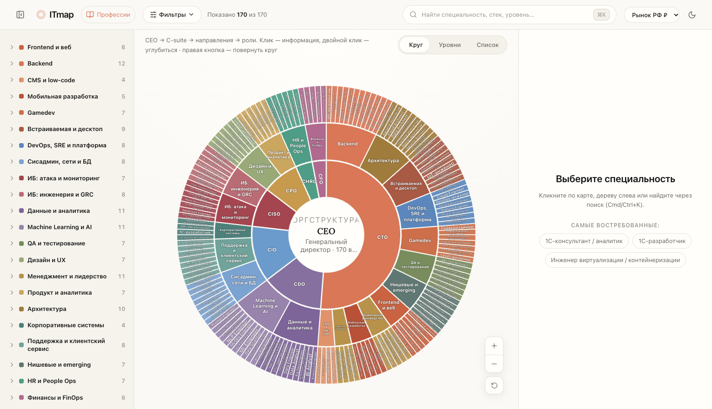

<div align="center">

# ITmap — интерактивная карта IT-специальностей

**Одна карта, на которой видны все IT-роли: чем занимаются, что в стеке, какие грейды и зарплаты, как растут и «кого искать» при найме.**

_An interactive map of every IT specialty — responsibilities, stack, grades, salaries, growth paths and hiring signals, all on one zoomable chart._

[](https://daminow.github.io/itmap/)
[](https://github.com/daminow/itmap/actions/workflows/ci.yml)
[](LICENSE)
[](LICENSE-DATA)
[](https://react.dev)
[](https://www.typescriptlang.org)
[](https://vite.dev)

### [→ Открыть живое демо / Open the live demo](https://daminow.github.io/itmap/)

Русский · [English](#english)



</div>

---

## Русский

**ITmap** — это статическое веб-приложение без бэкенда, которое показывает **170 ролей в 22 доменах**,
выстроенных как настоящая оргструктура IT-компании: **CEO → C-suite → департамент → роль**
(CTO, CDO, CPO, CISO, CIO, CHRO, CFO). Для каждой роли — краткое описание, обязанности, «кого искать»
при найме, стек, специализации, грейды с вилками и опытом, путь роста и смежные роли.

Полезно, если вы:

- **нанимаете** — понять, кто вам нужен, какой стек и вилку ожидать, кого смотреть в смежных ролях;
- **строите карьеру** — увидеть всю карту профессий, грейды и куда расти;
- **проектируете команду/оргструктуру** — окинуть взглядом всю IT-функцию сразу.

### Возможности

- **Открытый справочник**: [170 профессий](https://daminow.github.io/itmap/professions/) и 22 направления с отдельными HTML-страницами, доступными без JavaScript.
- **Проверяемые данные**: [происхождение и ограничения оценок](https://daminow.github.io/itmap/about/). Зарплаты — ориентиры справочника, а не актуальное исследование вакансий.

- **Три синхронизированных вида** (переключатель над картой):
  - **Круг** — зумируемый санберст: семейства → домены → роли видны сразу; клик по сектору плавно
    углубляет (анимированный arc-tween), колесо/кнопки — масштаб, перетаскивание — пан.
  - **Уровни** — icicle: колонки C-suite / департамент / роль с подписями, focus-zoom и хлебные крошки.
  - **Список** — доступное DOM-дерево (`role="tree"`) для клавиатуры и скринридеров.
- **Фильтры**: зарплата, опыт, стек, грейд, тип роли. Всё, что не проходит фильтр, приглушается —
  и приложение объясняет, **почему** («не совпал стек», «вне вилки» и т.п.).
- **Мульти-валюта** ₽ / $ / € с отображением по курсу, когда региональной оценки нет.
- **Шарящиеся ссылки**: состояние (фильтры, вид, выбор) кодируется в URL — скинул ссылку, коллега
  видит ровно тот же экран.
- **Доступность и производительность**: единое DOM-дерево как источник истины для AT, SVG-карта
  декоративна (`aria-hidden`); focus-trap в мобильном sheet; всё уважает `prefers-reduced-motion`.

### Быстрый старт

```bash
git clone https://github.com/daminow/itmap.git
cd itmap
npm ci          # установка строго из package-lock (нужен Node 22)
npm run dev     # дев-сервер на http://localhost:5173
```

### Команды

| Команда | Что делает |
| --- | --- |
| `npm run dev` | Дев-сервер с HMR |
| `npm run build` | Прод-сборка (`tsc -b && vite build`) в `dist/` |
| `npm run preview` | Локальный предпросмотр прод-сборки |
| `npm run typecheck` | Проверка типов без эмита |
| `npm run lint` | ESLint (в т.ч. кастомные гарды проекта) |
| `npm run format` | Prettier |
| `npm run test` | Vitest — весь набор (32 теста) |
| `npm run validate:data` | Валидация датасета (схема + целостность + контент-пороги) |

### Данные и методология

Зарплаты — **курируемые ориентиры рынка РФ на 2026 год**, а не оффер или гарантия. `rub` обязателен;
`usd`/`eur` заполнены только там, где есть реальная региональная оценка (никогда не выводятся из курса
в самом датасете). Контент правится в [`src/data/domains/*.ts`](src/data/domains/), после чего
`npm run validate:data` проверяет схему, целостность ссылок и пороги качества (≥3 обязанности,
≥2 сигнала найма, монотонность вилок по грейдам, отсутствие дублей и битых связей, ≤13 ролей на домен).

Подробности модели данных — в [docs/DATA_MODEL.md](docs/DATA_MODEL.md), как добавить роль/домен —
в [CONTRIBUTING.md](CONTRIBUTING.md).

### Безопасность

Статический клиент с жёсткой защитой: строгий **CSP** ([`public/_headers`](public/_headers)) —
`script-src 'self'`, `object-src 'none'`, `frame-ancestors 'none'`, `base-uri 'none'`,
`upgrade-insecure-requests`. Недоверенный ввод (URL/поиск) проходит хардненный декодер (валидация
диапазонов, кламп, пересечение с enum, whitelist параметров, защита от prototype-pollution). Без
`dangerouslySetInnerHTML`, без CDN (иконки — `lucide-react`, шрифт — self-hosted), zod в прод-бандле = 0 байт.
Как сообщить об уязвимости — [SECURITY.md](SECURITY.md).

### Стек

Vite 7 · React 19 · TypeScript 5.9 (strict) · Zustand (+ immer) · d3 (hierarchy / shape / zoom / interpolate / selection)
· @radix-ui/react-slider · lucide-react · Lora (self-hosted, `@fontsource`) · zod (только dev/CI).

Архитектура целиком — в [docs/ARCHITECTURE.md](docs/ARCHITECTURE.md).

### Лицензия

Двойное лицензирование, чтобы код был максимально открыт, а курируемые данные — защищены:

- **Код** — [Apache License 2.0](LICENSE) (с сохранением авторства и патентной оговоркой);
- **Датасет** (`src/data/`) — [CC BY-SA 4.0](LICENSE-DATA) (указание авторства + share-alike).

© 2026 Timur Daminov. Подробности — в [NOTICE](NOTICE).

---

## English

**ITmap** is a backend-free static web app that shows **170 roles across 22 domains**, arranged as a real
IT-company org chart: **CEO → C-suite → department → role** (CTO, CDO, CPO, CISO, CIO, CHRO, CFO). Every
role carries a summary, responsibilities, hiring signals ("who to look for"), stack, specializations,
salary/experience bands per grade, a growth path, and adjacent roles.

It helps if you are **hiring** (who do you actually need, at what stack and salary band), **building a
career** (see the whole map and where to grow), or **designing a team/org** (take in the entire IT
function at a glance).

### Features

- **Three synchronized views**: **Circle** (zoomable sunburst with animated drill-down), **Levels**
  (icicle with focus-zoom and breadcrumbs), and **List** (an accessible `role="tree"` DOM tree for
  keyboard and screen readers).
- **Filters**: salary, experience, stack, grade, role type — with a plain-language reason for anything
  that gets dimmed out.
- **Multi-currency** ₽ / $ / € with display-FX fallback where no regional estimate exists.
- **Shareable URLs**: filters, view and selection are encoded in the URL through a hardened codec.
- **Accessibility & performance**: DOM tree is the source of truth (SVG is decorative), focus-trap in the
  mobile sheet, and `prefers-reduced-motion` is respected throughout.

### Quick start

```bash
git clone https://github.com/daminow/itmap.git
cd itmap
npm ci          # exact install from the lockfile (requires Node 22)
npm run dev     # dev server at http://localhost:5173
```

See [`package.json`](package.json) for all scripts. Key ones: `npm run build`, `npm run test`
(32 tests), `npm run typecheck`, `npm run lint`, and `npm run validate:data` (dataset validation).

### Data & methodology

Salary figures are **curated reference points for the Russian IT market (2026)** — not offers or
guarantees. `rub` is mandatory; `usd`/`eur` are filled only where a genuine regional estimate exists
(never FX-derived in the dataset). Content lives in [`src/data/domains/*.ts`](src/data/domains/) and must
pass `npm run validate:data`. See [docs/DATA_MODEL.md](docs/DATA_MODEL.md) and
[CONTRIBUTING.md](CONTRIBUTING.md).

### Security

Hardened static client: strict **CSP** in [`public/_headers`](public/_headers), a hardened URL/search
decoder, no `dangerouslySetInnerHTML`, no third-party CDNs (icons via `lucide-react`, self-hosted font),
and zod shipping 0 bytes to production. Report vulnerabilities via [SECURITY.md](SECURITY.md).

### Tech stack & architecture

Vite 7 · React 19 · TypeScript 5.9 (strict) · Zustand (+ immer) · d3 · @radix-ui/react-slider ·
lucide-react · Lora (self-hosted). Full write-up in [docs/ARCHITECTURE.md](docs/ARCHITECTURE.md).

### License

Dual-licensed so the code stays maximally open while the curated data stays protected: **code** under
[Apache-2.0](LICENSE), **dataset** (`src/data/`) under [CC BY-SA 4.0](LICENSE-DATA). © 2026 Timur Daminov.
See [NOTICE](NOTICE).

### Contributing

Contributions — especially data corrections with sources — are welcome. Start with
[CONTRIBUTING.md](CONTRIBUTING.md) and the [Code of Conduct](CODE_OF_CONDUCT.md).
